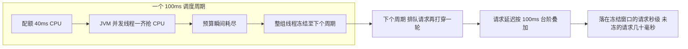
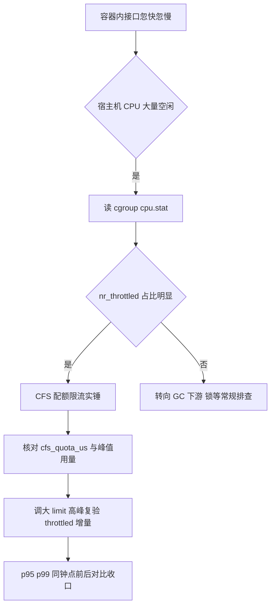

## 概述

线上一套微服务里的移动端查询接口突然"忽快忽慢"：快的时候几十毫秒返回，慢的时候要等上秒级，而且**同一个接口、同样的参数**，前后两次请求表现完全不同。服务是双副本部署，监控大盘上宿主机 CPU 长期 90% 以上空闲——看起来谁都不缺资源。

- **故障现象**：同一查询接口延迟呈双峰分布（几十 ms / 秒级），双副本中一个 pod load 6+、三十个线程处于运行态，另一个 pod load 0.5、全部休眠；
- **根因**：Pod 的 CPU limit 只有 **0.4 核**（`cpu.cfs_quota_us=40000/100000`），繁忙副本在 **38.8%** 的调度周期里打穿 CFS 配额被整体冻结，所有业务线程以 100ms 为台阶周期性停摆；
- **关键反直觉点**：该 pod 平均 CPU 用量只占配额的 25%，"平均很闲"与"高频被限流"并不矛盾——**限流看的是峰值，不是均值**。

调大 limit 后 `nr_throttled` 归零、接口延迟恢复平稳。这篇复盘记录完整排查路径，以及两个值得单独记录的坑：top 的 `TIME+` 单位误读（差 60 倍），和容器里没有 jcmd/jstat 时的取证替代。

<!-- more -->

## 一、现象：直觉会把你带偏的现场

接到报障时，能拿到的信息是这样的：

- 同一个查询接口，时快时慢，没有规律；
- 双副本部署，出问题时**只有一个 pod 表现异常**：load 6.6，`top -Hp` 里三十个 `http-nio` 业务线程全部 R 态；
- 宿主机 CPU 92% idle，内存无压力。

"接口慢"的常规怀疑方向——SQL 没走索引、下游服务抖动、GC 停顿——都解释不了这个组合里的两个特征：

1. **同一请求时快时慢**：数据库或下游的问题通常表现为"某段时间全慢"，而不是同一时刻一部分请求快一部分慢；
2. **两个副本行为撕裂**：同一镜像同一配置，一个忙死一个闲死。

第一个真正有用的线索藏在 `top -Hp` 的细节里：三十个线程全是 R 态（可运行），**单个线程的 %CPU 却只有 0.6~2.5%**。线程都"想跑"却没跑起来，CPU 花到哪去了？——没花出去，是被什么挡住了。在容器里，挡住它们的最常见的东西就是 cgroup 的 CPU 配额。

## 二、第一现场：cgroup 的 cpu.stat

两个 pod 各执行一条命令：

```bash
cat /sys/fs/cgroup/cpu/cpu.stat
```

返回值对比（cgroup v1 路径）：

| 指标 | 慢 pod | 快 pod |
|---|---|---|
| nr_periods | 6,959,058 | 6,952,914 |
| **nr_throttled** | **2,697,487** | 96,200 |
| 被限流周期占比 | **38.8%** | 1.38% |

三个字段的含义：

- `nr_periods`：经历的调度周期数。内核按 **100ms 一个周期（period）** 给设了 CPU limit 的 cgroup 发放 CPU 预算，这里约 695 万个周期 ≈ 服务已运行 8 天；
- `nr_throttled`：预算在周期内被耗尽、**整个 cgroup 被冻结**的周期数；
- `throttled_time`：被冻结的累计时长（跨任务累计，参考价值不如前两者直观）。

38.8% vs 1.38%——同一 deployment 的两个副本，一个每十个调度周期就有近四个打满配额被冻，一个几乎无感。**"忽快忽慢"和"副本撕裂"两个特征同时有了着落**：请求落到慢 pod 且恰逢冻结窗口就慢，落到快 pod 或未冻结时刻就快。

再补一刀，确认配额到底是多少：

```bash
cat /sys/fs/cgroup/cpu/cpu.cfs_quota_us /sys/fs/cgroup/cpu/cpu.cfs_period_us
# 40000
# 100000
```

40000µs / 100000µs = **0.4 核**。对一个跑着 Tomcat 线程池、Redis 订阅、RxJava 调度器和并行 GC 的 JVM 来说，这个额度相当紧张。

## 三、机制：0.4 核是怎么把延迟变成"台阶"的

CFS 配额的工作方式：每个 100ms 周期开始时，cgroup 获得 40ms 的 CPU 时间片预算（0.4 核 × 100ms）。**这个周期内所有线程加起来只能消耗 40ms**，烧完之后——不管周期还剩多少毫秒——该 cgroup 的**全部线程集体冻结**，等下一个周期重新发预算：



这就解释了最容易困惑的一点：**为什么平均用量只有配额的 25%，却有 38.8% 的周期被限流？**

慢 pod 八天累计 CPU 约 19 小时，折算均值 0.10 核，确实是 0.4 核配额的四分之一。但限流判断发生在每个 100ms 窗口内：JVM 处理请求是几十个线程并行的，一波并发查询加上 GC 的并行线程一齐上，40ms 预算可能在十几毫秒内就被烧光，剩余 80ms 全员冻结。冻结解除后积压的请求再抢新预算，又立刻打穿——**突发负载 + 小配额 = 高频限流，跟均值没关系**。

请求侧的体感就是：一条本来 50ms 的查询，运气差时被冻两三个周期，直接变成 300ms+；再叠加排队，秒级也出来了。延迟分布双峰，峰的位置大致是 100ms 的整数倍——这是 CFS 限流的签名。

## 四、修复与验证口径

修复动作本身很朴素：调大 deployment 的 CPU limit 与 request。发布后新 pod 的 `cpu.stat`：

```text
nr_periods 10411
nr_throttled 0
throttled_time 0
```

接口延迟明显回落。但这里有两个验收口径要注意，**别在发布后十分钟就宣布胜利**：

1. **`nr_periods 10411` × 100ms ≈ 17 分钟**——新 pod 才刚起，0/10411 只说明开局干净。之前那个 pod 也是业务突发时段才打穿配额的，**至少跑满一个业务高峰时段**，确认高峰期 `nr_throttled` 增量持续为 0，才算稳。可以起个小循环盯着：

   ```bash
   while :; do
     a=$(awk '/nr_throttled/{print $2}' /sys/fs/cgroup/cpu/cpu.stat); sleep 1
     b=$(awk '/nr_throttled/{print $2}' /sys/fs/cgroup/cpu/cpu.stat)
     echo "$(date +%T) +$((b-a))"
   done
   ```

2. **验收指标是延迟，不是 throttled**：从网关/接入层日志拉该接口 p95/p99 的前后对比，且要**同钟点窗口**（昨天 14 点段对今天 14 点段），避免流量模式差异污染结论。顺手用 `kubectl top pod --containers` 看一眼峰值实际用量，给 limit 留 3~5 倍余量。

再往前想一步：这次是 38.8% 才被用户感知撞见，属于"用户先于监控发现问题"。建议给 throttled 周期占比加个告警（比如 >1% 持续 5 分钟），下次这类问题会在用户报障之前冒头。

## 五、踩坑实录

### 5.1 top 的 TIME+ 是"分:秒"，不是"时:分"

排查中我犯过一个差 60 倍的误读。`top -Hp` 输出里有个线程累计 CPU 显示为 `525:14.37`，我第一反应读成了"525 小时"——按服务运行 8 天折算，等于这个线程常年独占 2.7 个核，一度把方向带偏到"某个 RxJava 调度线程在空转烧 CPU"。

实际上 top 的 `TIME+` 格式是 **分:秒.厘秒**，分钟数可以超过 60：`525:14.37` = 8 小时 45 分。按正确单位重算，该线程只占 0.045 核，是个正常角色。

教训值得刻在墙上：**单位核对先于归因**。由误读推出的结论哪怕逻辑再自洽、故事再通顺，也是错的——而且它通常会显得格外"合理"，让你舍不得怀疑它。

### 5.2 容器里没有 jcmd/jstat

想抓线程栈和 GC 数据时发现镜像里没有 JDK 工具链（JRE 精简镜像的常见情况）。替代方案，全部只依赖 `/proc` 和信号：

```bash
# 1. JDK 可能装了只是没进 PATH——java 进程在跑，先看它的 bin 目录
JB=$(dirname $(readlink -f /proc/<pid>/exe)); ls $JB | grep -E 'jcmd|jstack'
$JB/jstack <pid> | grep -A 25 -i 'RxComputation'

# 2. 兜底：SIGQUIT 只触发线程 dump，不会杀进程，输出到进程 stdout
kill -3 <pid>
kubectl logs <pod> --tail=800 | grep -B2 -A25 -i '线程名'

# 3. 纯 shell 排线程 CPU（字段14+15 = utime+stime，单位 tick，100 tick ≈ 1s）
for d in /proc/<pid>/task/*; do awk '{print $14+$15, $2}' $d/stat 2>/dev/null; done \
  | sort -rn | head -15

# 4. 看 JVM 启动参数（堆大小、是否感知容器配额、GC 类型）
tr '\0' ' ' < /proc/<pid>/cmdline; echo
```

第 4 条在 CPU 限流场景还有额外价值：如果 JVM 没有感知容器配额（老版本 Java 8 未开 `UseContainerSupport`），GC 会按宿主机核数开并行线程，几十个 GC 线程在 0.4 核配额里一齐转，等于专门为限流添柴——此时补 `-XX:ActiveProcessorCount` 能显著缓解突发打穿。

## 六、小结

把这次排查压缩成一张决策图，下次遇到同类问题可以直接套：



几条沉淀下来的经验：

1. **容器内服务"慢但宿主机闲"，第一眼看 `cpu.stat`**——两个数字（`nr_throttled/nr_periods`）就能定性，成本极低；
2. **限流看峰值不看均值**：均值占配额 25% 也能有 38.8% 的周期被打穿，"平均用量离 limit 还很远"不是安全证据；
3. **几十个线程全 R 态、单线程 %CPU 却极低** = 被 cgroup 冻住的典型形态，看到这个组合别再去查业务代码；
4. **`TIME+` 是分:秒**，读数前先对单位，归因前先对量级；
5. **验收要过高峰**：刚发布的 pod `nr_throttled=0` 只是开局干净，跑满业务高峰 + p95/p99 同钟点对比才算闭环。

最后留个尾巴：这次数据里还有一个未追到底的疑点——两个副本之间存在**长连接/订阅类的负载倾斜**（后台调度与消息订阅线程的 CPU 是 2.7×/2.9×，而 HTTP 处理量只差 1.35×），说明相当一部分长连接粘在了单个 pod 上。配额放宽后它暂时无害，但这是"单 pod 慢"类问题的下一个常见嫌疑，记在这里备查。
