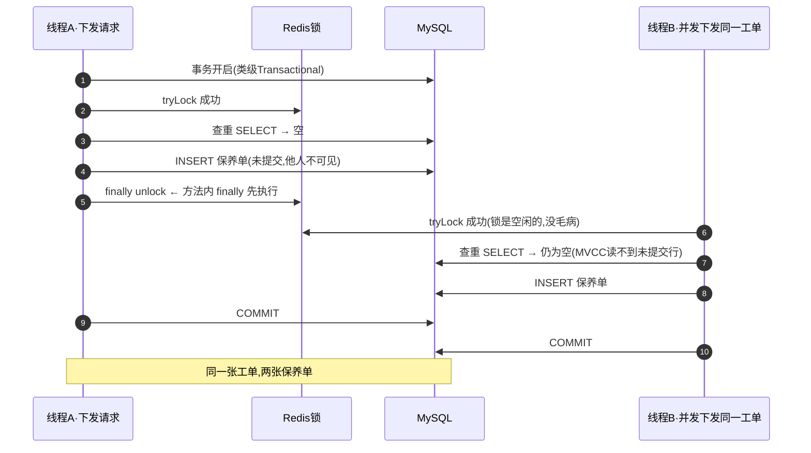
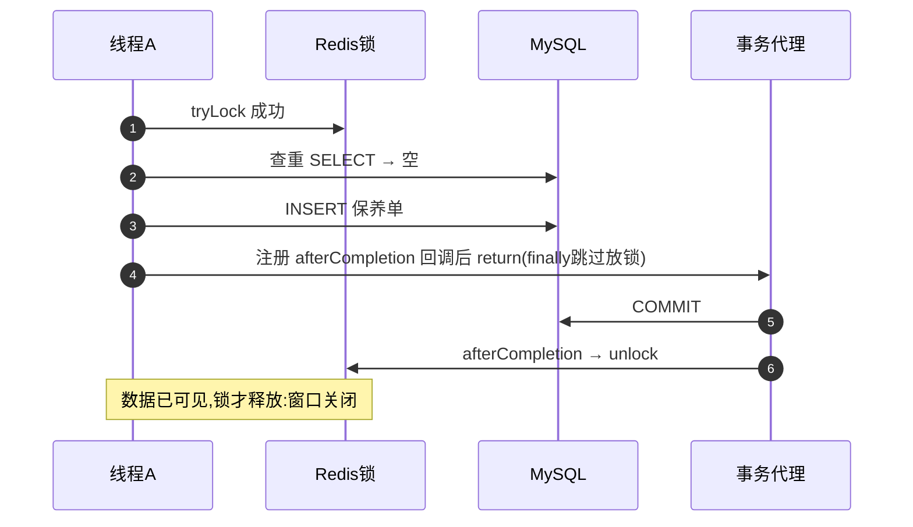
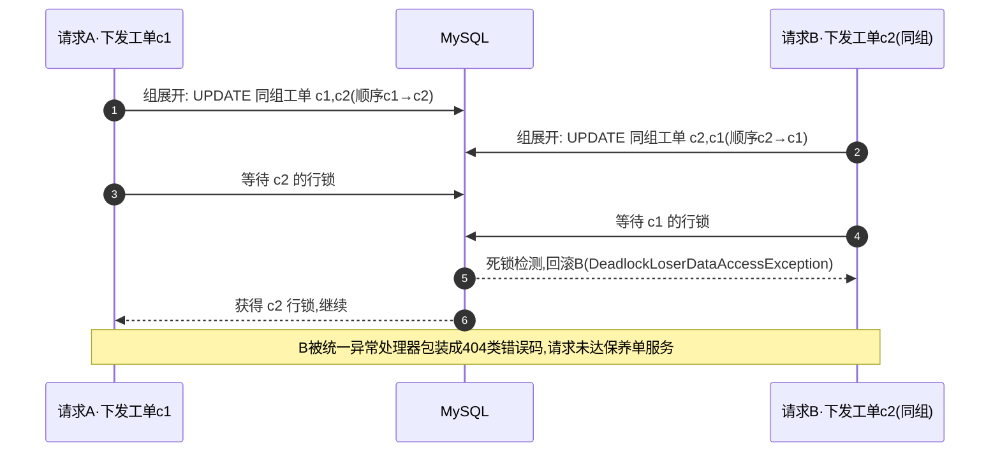

代码评审里最有力的一种意见，不是"这里可能有空指针"，而是**"你的注释和你的代码在说两件事"**。前两天收到一条这样的评审：

> `batchCreatePlans` 循环内 `finally` 提前释放分布式锁，与加锁注释的意图矛盾——并发派工会重复生成保养单。

背景是一套注塑 MES：成型工单下发时，系统要为工单所用模具生成一张"上模保养单"（模具装上机台前先做保养，保养未完成不允许开工）。同模具多腔的一组工单共享同一个组标识（`group_flag`），同组只生成一张保养单。生成入口简化后长这样——**有分布式锁、有查重、查重 SQL 还按组展开**，乍看固若金汤：

```java
@Service
@Transactional(rollbackFor = Exception.class)   // ← 类级声明式事务
public class MaintenancePlanService {

    public Map<String, Object> batchCreatePlans(List<Map<String, Object>> orders) {
        for (Map<String, Object> order : orders) {        // 批量下发一次带多张工单
            String uniqueKey = factoryId + "-" + order.get("orderId");
            if (!lockService.tryLock(LOCK_NAME, uniqueKey)) {
                return busyError;                          // "正在生成,请稍后再试"
            }
            try {
                if (existsSamePlan(order)) {               // 查重: 已有同模具保养单则跳过
                    existedCount++;
                    continue;
                }
                createPlan(order);                         // INSERT 保养单主表 + 四张关联表
            } finally {
                lockService.unlock(LOCK_NAME, uniqueKey);  // ← 评审矛头所指
            }
        }
    }
}
```

`lockService` 是框架对 Redisson 的封装：`tryLock` 内部是 `getLock(key).tryLock()`（拿不到立即失败，不等待），`unlock` 内部是 `isHeldByCurrentThread() → unlock()`，按线程持有、可重入。保养单表上**没有任何业务唯一索引**，`existsSamePlan` 这一句 SELECT 是去重的唯一守卫。

实测：并发下发同一张工单，库里出现两张保养单。这篇就沿着这条评审意见，拆开"分布式锁与 Spring 事务生命周期错位"的完整机制、修复模板里的版本坑、锁粒度这层更隐蔽的漏口，以及并发 bug 特有的"洋葱式"验证方法。和之前那篇单号重复事故（）是同根同源的两类翻车：都是"查一下再写"撞上事务隔离，只是一个死在锁外、一个死在锁内。

<!-- more -->

## 一、事故还原：有锁、有查重，为什么还会重复

### 1.1 先把执行结构看清楚：事务在方法外面，finally 在方法里面

`@Transactional` 是 AOP 动态代理在方法**外面**包事务，而 `try-finally` 写在方法**里面**。等价的执行结构是：

```java
// 外层: Spring 事务代理（框架生成，开发者看不见）
public Object proxyBatchCreatePlans(orders) {
    TransactionStatus tx = txManager.getTransaction(def);      // 1. 开事务
    try {
        Object result = target.batchCreatePlans(orders);       // 2. 进内层业务方法
        //    内层: 拿锁 → 查重 → INSERT → finally{放锁} → return  ← 3~5 全部先于 commit
        txManager.commit(tx);                                  // 6. 内层彻底出栈后才提交
        return result;
    } catch (Exception e) {
        txManager.rollback(tx);
        throw e;
    }
}
```

Java 语法规定：finally 在控制权离开方法前（return 或抛异常时）必须立即执行，它不可能被推迟到外层代理的 `commit()` 之后。**这是机制，不是写法问题**——只要放锁代码写在业务方法内的 finally 里，它就必然早于事务提交。

### 1.2 竞态时序



三个知识点叠出来的事故，和单号重复那篇同源但多了一层讽刺——**这次明明有锁**：

1. **finally 的执行时机由 Java 语义钉死**。方法内部任何位置的 finally 都在方法返回前执行，而 commit 在方法返回后由外层代理发起，两者中间隔着一次完整的栈帧弹出；
2. **未提交的数据对并发连接不可见**。INSERT 的 SQL 已经发到 MySQL、行锁已加，但事务没提交，别的连接做一致性读（普通 SELECT）读不到这行。B 拿到锁之后查重为空，不是 B 的错——它的世界里确实还没有这张保养单；
3. **没有唯一索引兜底**。重复行静默落库，没有 DuplicateKeyException 替我们拦一道。

还有个容易低估的点：**即使没有循环、方法体只处理一张单，最后一次 finally 依然早于 commit**。循环只是把窗口放大 N 倍——批量请求 A 处理到第 3 张工单时，它自己第 1 张工单的锁早就放掉了、数据还没提交，任何人此刻并发第 1 张工单都会穿透。每次循环一把锁，等于把"没锁"的时间段切成了 N 份轮流暴露。

### 1.3 一句话定性

Redisson 的锁和 MySQL 的事务是**两个互不知情的系统**：锁只认 Redis 里的键，事务只认数据库连接。锁的释放时机必须人工对齐到"数据真正对他人可见"那一刻——也就是事务提交完成之后。这就是标题说的"先提交，再放锁"。

## 二、第二层漏口：锁的粒度和查重的粒度不一致

把释放时机修对之后，问题并没有穷尽。再看一眼查重 SQL 的语义（按组展开）：

```sql
select ... from maintenance_plan p
where p.factory_id = #{factoryId}
  and ( p.order_id = #{orderId}
        or p.order_id in (
            select c1.id from order_child c1
            join order_child c2 on c1.group_flag = c2.group_flag
            where c2.id = #{orderId} ) )
-- Java 侧再比对 plan.mold_id 与当前工单模具是否一致
```

查重的语义是**组**（"这张工单、或与它同组的任何工单，已有同模具保养单"），而锁键是 `factoryId + orderId`——**单**。

也就是说：同组两张工单 c1、c2 并发下发，A(c1) 拿 `1-c1` 的锁，B(c2) 拿 `1-c2` 的锁，两把锁互不排斥，双方都畅通无阻地走到查重——然后撞上第一节说的未提交不可见，照样重复建单。**这层漏口和释放时机无关，把锁持有到天荒地老也堵不住**，因为根本没互斥上。

这层比时序错位更隐蔽：时序问题至少会在注释与代码的矛盾里露馅，粒度问题读单边代码完全看不出来，必须把**锁键表达式**和**去重查询的 WHERE 语义**摆在一起比对。规律一句话：

> **锁键的粒度，必须不粗于查重查询的语义粒度。** 查重按组，锁就必须按组；锁比查重粗（一把大锁）正确但低效，锁比查重细（按单加锁、按组查重）就是漏。

业务上还有个必须确认的口径：这套系统里**非同组工单没有组标识**（`group_flag` 是空串而非 NULL），所以锁键要做岔路——同组按 `factoryId + group_flag`，非同组退回 `factoryId + orderId`。这种岔路别自己拍脑袋，要和业务确认（我就确认过一轮：不能假设所有单都有组标识）。

## 三、修复：把锁的生命周期托管给事务

修复后的核心循环（等价改写为通用形态，真实代码结构一致）：

```java
for (Map<String, Object> order : orders) {
    // 锁键: 与查重语义同粒度——同组按组标识互斥, 无组标识退回自身单号
    String groupFlag = (String) order.getOrDefault("group_flag", "");
    final String uniqueKey = "".equals(groupFlag)
            ? factoryId + "-" + order.get("orderId")
            : factoryId + "-" + groupFlag;
    if (!lockService.tryLock(LOCK_NAME, uniqueKey)) {
        return busyError;   // 提示里带单号, 方便用户定位
    }
    // 锁须持有到事务 afterCompletion 再释放: Redis 锁与数据库事务解耦,
    // 循环内 finally 提前释放会让并发请求在本事务 INSERT 提交前拿到锁,
    // 查不到未提交的保养单而重复生成; 事务同步不活跃时退回 finally 释放兜底
    boolean releaseByTransaction = false;
    try {
        if (TransactionSynchronizationManager.isSynchronizationActive()) {
            TransactionSynchronizationManager.registerSynchronization(new TransactionSynchronizationAdapter() {
                @Override
                public void afterCompletion(int status) {
                    lockService.unlock(LOCK_NAME, uniqueKey);
                }
            });
            releaseByTransaction = true;
        }
        if (existsSamePlan(order)) { existedCount++; continue; }
        createPlan(order);
    } finally {
        if (!releaseByTransaction) {
            lockService.unlock(LOCK_NAME, uniqueKey);
        }
    }
}
```

修复后时序：



配套还有一行容易漏的改动：**上游服务的下发 payload 原来没传 `group_flag`**，本服务拿不到组标识就只能退回单号粒度——加锁方和传参方必须一起改，否则修复只生效一半。

下面这些实现细节，网上流传的模板几乎每一处都有人栽跟头。

### 3.1 Spring 5.1.x 必须用 Adapter，不能直接匿名实现接口

很多文章写的是：

```java
TransactionSynchronizationManager.registerSynchronization(new TransactionSynchronization() {
    @Override
    public void afterCompletion(int status) { ... }
});
```

这在 Spring 5.3+ 没问题——5.3 起 `TransactionSynchronization` 接口的方法全部有了默认实现。但我们的框架停在 Spring 5.1.x，这个接口的 `suspend()/resume()/beforeCommit()/beforeCompletion()/afterCommit()/afterCompletion()` **全是抽象方法**，匿名类只覆写一个方法根本编译不过。5.1.x 的正确写法是继承 `TransactionSynchronizationAdapter`（空实现适配器，5.3 里已标记废弃）。

动手前先看一眼自己的 spring-tx 版本，别把"新版的便利"抄进"旧版的工程"。

### 3.2 选 afterCompletion，而不是 afterCommit

事务同步回调有两个释放候选点：

- `afterCommit`：只在成功提交后触发。如果事务**回滚**，注册的释放逻辑永远不会执行——锁泄漏，只能等 Redisson 租约到期/watchdog 断供，期间同键请求全部 busy；
- `afterCompletion(status)`：提交、回滚都会触发，`status` 参数区分 `STATUS_COMMITTED` / `STATUS_ROLLED_BACK`。

放锁的语义是"这把锁的历史使命结束了"，与事务成败无关——所以选 `afterCompletion`。顺带一提，`afterCompletion` 里抛的异常会被 Spring 捕获后只打日志、不传播，释放逻辑自身要稳。

### 3.3 同线程回调，Redisson 的按线程持有才成立

Redisson 的 `unlock` 校验持锁线程（`isHeldByCurrentThread`）。`afterCompletion` 由**完成事务的那个线程**回调——标准同步事务（请求线程一路执行到底）里就是业务线程本身，所以 unlock 正常。这也是不能把释放扔进异步线程池随手 unlock 的原因：换了线程，Redisson 直接 `IllegalMonitorStateException`。有的参考文章提 `forceUnlock` 或 Lua 校验锁值（不校验线程、只校验随机值），那是异步释放场景的不得已手段；既然同线程回调是标准行为，没必要引入 force 语义——它连别人的锁都能强拆。

### 3.4 匿名类里的两个小陷阱

- `uniqueKey` 被匿名类捕获，必须是 `final`（或事实 final）；
- 匿名类里写 `this.getClass()` 拿到的是**匿名类自己**——如果锁名是拿类名拼的（我们的框架正是 `锁名 = 类名 + 方法 + 键`），拼出来的名字和加锁时对不上，轻则释放失败，重则两把"不同的锁"互不排斥，问题绕回原点。必须写 `OuterClass.this.getClass()`。

### 3.5 finally 兜底：事务同步不活跃时

`isSynchronizationActive()` 为假（方法没被事务代理包住、传播行为是 NOT_SUPPORTED、或自调用绕过了代理）时注册不生效，`releaseByTransaction` 保持 false，finally 里照常释放。**注册动作放 try 里 + 标志位**是这个兜底成立的关键：注册本身抛异常时标志位来不及置位，finally 仍然兜底，不会死锁。

### 3.6 可重入性救了"一个事务里锁多把键"

这个循环在一次事务里对多张工单各拿各的锁（同组工单键相同、非同组键不同）。Redisson 锁可重入、按（线程, 键）计数：同一事务对同一个组键多次加锁是计数累加，每个键各自注册一次 `afterCompletion`、各自抵扣一次，互不干扰。如果换成不可重入的实现（比如裸 SETNX），还得再加一层"本请求已持有的键"去重。

## 四、被否决的方案：循环拆 REQUIRES_NEW，逐单提交逐单放锁

通用建议会说：循环里所有锁都活到整事务结束（第 1 把锁 = 全部 N 次插入 + 提交的总时长），不好；应该拆 `REQUIRES_NEW` 每单独立事务，"处理一条、提交一条、放一把锁"。评估过，这里**不拆**：

1. **锁活到事务结束恰恰是正确性的来源，不是副作用。** 去重保证的定义就是"锁保护到数据对下一个请求可见为止"。拆成子事务确实缩短持锁时间，但换来批量原子性语义变化——中途失败时前面已提交的单不回滚，调用方拿到的失败响应与库内事实不一致；
2. **发号本来就不同源。** 保养单号来自独立的序列服务（Redis/DB 发号），不在这个事务里——事务回滚后号已消耗、不会退回，"全或无"本来就是近似。既然原子性并非铁板一块，为它付出 N 次事务往返 + 每次提交刷盘的代价不划算；
3. **持锁时长的实际风险可控。** Redisson 的 watchdog 会在持锁线程存活期间自动续期，不会"事务还没提交锁先过期"；而 `tryLock` 不等待，同键并发请求立刻收到 busy 而非排队，持锁再长也不会堆积请求线程。

这不是说拆事务永远是错的——循环体很重（每单几百毫秒）、并发度高、且业务接受逐单提交语义时，`REQUIRES_NEW` + 逐单释放是正解。要点是：**这是语义取舍，不是谁对谁错**。

另外记一个循环配事务的经典暗坑（本例没踩但值得一排）：循环体内 catch 单条业务异常且不抛出时，外层事务不回滚会继续跑——上面"注册放 try 内 + 标志位"的结构同时防住了这类路径下的锁泄漏。

## 五、被缓办的方案：唯一索引兜底，卡在去重键活在别的表

通用建议的最后一招：给业务表建唯一索引做最终防线，防 Redis 主从切换丢锁、超长 GC 停顿等极端穿透。方向没错，落到这张表上没那么直接——

去重语义是"**同模具 × 同组** 已有保养单（含已完结）则不建"，而"组"是工单表的属性，保养单表上存的只是触发建单的那张工单号。`unique(factory_id, mold_id, order_id)` 挡不住"同组另一张工单"这条穿透路径；要表达组语义，得把组标识冗余进保养单表，再对 `coalesce(group_flag, concat('order-', order_id))` 这类推导键建唯一索引。跨表语义进约束，意味着：存量重复数据先清、通用插入通道的报错呈现（元数据驱动的通用 insert 不认业务错误码，唯一键冲突会以裸 DB 异常怼到用户脸上）都要跟着改。锁修好后穿透需要"Redis 丢锁 + 恰好同组并发"双条件叠加，概率已压到可接受，唯一索引记为后续加固项而非本次必做。

这节想说的是：**"标准建议"要过一遍自己的表语义再落地**。模板里的 `(设备ID, 计划周期)` 唯一索引很好，但你的去重键如果和这里一样活在隔壁表里，抄过来就是个心理安慰。

## 六、怎么验证：行为证据，不是日志证据

并发 bug 最容易被糊弄的一环是验证。这次的做法是**先复现、再修复**：写并发脚本直调服务接口——一张工单 X 混在批量请求 A 里首发，8 个线程错峰几十毫秒间隔重入同一张 X。修复前实锤复现：X 名下落了两张保养单，INSERT 已到库、铁证。**修完不能复现，才算修完。**

修复后三场景全绿：

| 场景 | 结果 |
|---|---|
| S1 同单并发（批量 + 8 线程竞入） | 8/8 全部 busy、库里仅 1 张单、批量侧全部建成功 |
| S2 同组不同单并发 | 同组两请求互斥，败方 busy——**报错文案里引用的是它自己那张工单号**，证明两张"不同的单号"确实争到了同一把组键锁 |
| S3 顺序回归 | 第二次请求 existedCount=1 跳过、无锁泄漏（锁泄漏会表现为后续请求永远 busy） |

S2 那个文案细节值得单独说：框架的锁操作不走应用日志（logger 级别过滤，grep 不到任何锁行为记录），想证明"锁键按组生效"没有日志可看，唯一的 observable 就是 busy 报错带上请求自己的工单号——**日志缺失时，把证据设计进行为里**。

最后补真实链路回归：走网关 → 上游工单服务 → 跨服务调用 → 本服务完整下发一遍，确认修复没破坏正常单笔路径。

## 七、修好一层互斥，露出下一层竞态

真实链路的并发验证还炸出一个意外：并发下发同组两张工单，败方收到框架包装的错误码「请联系系统运维人员协助解决」。追日志发现请求**根本没到本服务**——死在上游工单服务的派工流程里：



两个请求各自按组展开同组工单、以**相反顺序** UPDATE 同一批行，MySQL 死锁检测杀掉一个。这是个既有的并发缺陷，与本次修复无关——不做这次修复，它被锁问题挡在更外面根本看不见。但它示范了两件事：

1. **并发缺陷是洋葱**。外层时序错位修掉，才显出锁粒度层；粒度修掉，才显出上游死锁层。每修一层都要重跑并发验证，别指望一次修净；
2. **跨服务调用的"404"不一定是"没这个接口"**。目标服务没起、目标服务处理链上的任何异常，经无 fallback 的降级包装 + 统一异常处理后长得一个样。排障要同时 grep 调用方和目标方两侧日志，先确认"请求到底到没到"，再谈别的。

## 八、收束成清单

把这次的全部教训压成可复用的检查项：

1. **`grep unlock`**：凡是 `finally` 里释放分布式锁、且类/方法带 `@Transactional` 的，先画时间线——放锁早于 commit 即有竞态窗口，与方法里有没有循环无关；
2. **锁键粒度 vs 查重语义粒度**逐对比对：查重 WHERE 按什么聚，锁键就按什么聚；键里有业务岔路（同组/非同组）的，岔路口径要和业务确认；
3. **释放点选 `afterCompletion`**（回滚也要放锁），Spring 5.1.x 用 `TransactionSynchronizationAdapter`，5.3+ 才能直接匿名实现接口；
4. **注册放 try 内 + 标志位 + finally 兜底**，防"事务同步不活跃"和"注册抛异常"两条路径的锁泄漏；
5. **匿名类细节**：捕获键加 final；`OuterClass.this.getClass()` 拿正确的锁名；
6. **加锁方与传参方一起改**：上游不传组标识，服务端修复就只有一半效果；
7. **验证三件套**：修复前实锤复现、修复后并发 + 顺序回归、真实链路单笔回归；日志看不到锁行为时，把证据设计进响应行为（busy 带定位单号）；
8. **唯一索引兜底要过表语义关**：去重键活在别的表里，索引就落不了地——先补冗余列再谈约束，或者明确接受残余概率；
9. **每修一层并发，重跑一次并发**：下一层竞态（比如上游组展开死锁）只有外层修好后才会显形。

一句话总结：**分布式锁和数据库事务是两个互不知情的系统，"拿锁→查重→写入"的正确性只在"数据已对他人可见"这一刻才真正成立——所以锁必须活过 commit。写代码时把这句话变成 `afterCompletion`，评审时把它变成对每一处 `finally { unlock }` 的条件反射。**
